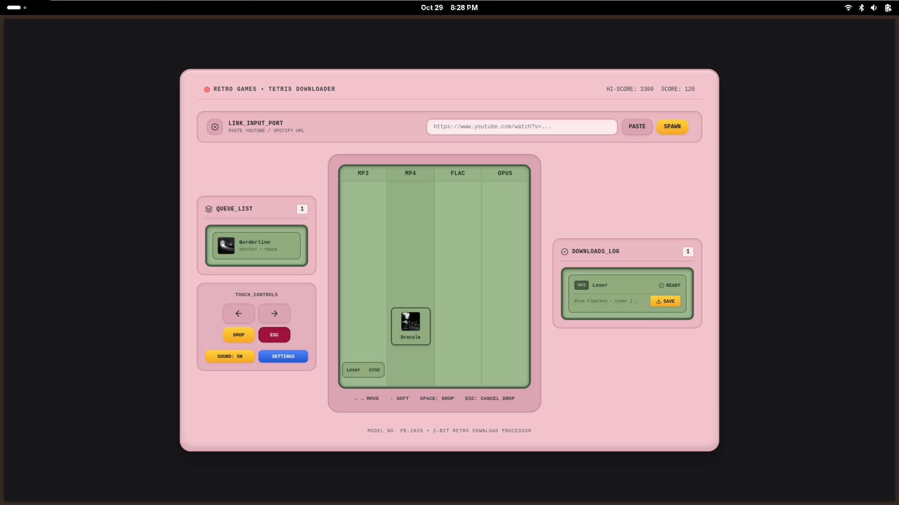
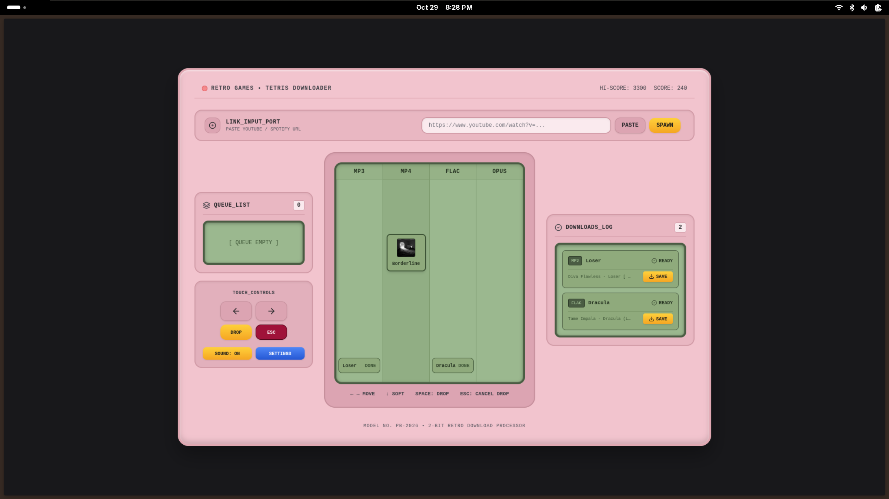
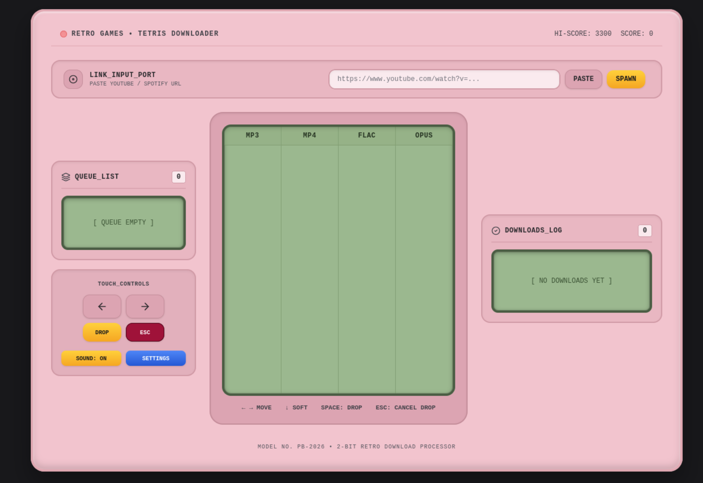

# DropBox Tetris 🕹️🎵

> **Model No. PB-2026 • 2-Bit Retro Download Processor**

DropBox Tetris is a retro-arcade style download manager web app where falling pieces are YouTube and Spotify links. Steer each falling media block onto a format bar lane at the bottom (`MP3`, `MP4`, `FLAC`, `OPUS`) to initiate high-speed audio and video downloads powered by `yt-dlp` and `ffmpeg`.

---

## 📸 Interface Screenshots

### 1. Main Console & Link Input Port


### 2. Arcade Gameplay & Falling Media Blocks


### 3. Downloads Log & Saved Files Panel


---

## ✨ Features

- **Arcade Gameplay & Controls**: Move falling media blocks across columns (`MP3`, `MP4`, `FLAC`, `OPUS`) using arrow keys, soft drop, and hard drop.
- **Next-Up Queue Preview**: Side queue displaying upcoming YouTube and Spotify URLs with thumbnail previews.
- **Live Progress Tracking**: Locked blocks transform into live progress bars streaming real-time download progress via Server-Sent Events (SSE).
- **Lane Compatibility Engine**: Incompatible drops (e.g., audio-only Spotify tracks into MP4 video lane) bounce back with arcade shake animations and helpful feedback tooltips.
- **Retro Audio**: Chiptune sound effects generated via the Web Audio API (move, drop, lock, clear, error).
- **Comprehensive Format Options**: MP3 (configurable bitrate), MP4 (video+audio merge), FLAC (lossless container note), OPUS, M4A, WAV, and WEBM.
- **Completed Files Panel**: Quick access to download and save finished media files directly to your device.
- **Robust YouTube & Spotify Resolution**: Automatic metadata and thumbnail extraction with zero-configuration fallback support.

---

## 🚀 How to Use

1. **Paste a URL**: Paste any YouTube watch/playlist URL or Spotify track/album/playlist URL into the **LINK_INPUT_PORT** at the top and click **SPAWN** (or press Enter).
2. **Steer the Falling Block**: As your media link falls down the screen:
   - Use **`←` / `→` arrow keys** (or touch D-pad buttons) to move the block left or right into the desired format lane (`MP3`, `MP4`, `FLAC`, or `OPUS`).
   - Use **`↓` arrow key** for soft drop.
   - Press **`Spacebar`** for an instant hard drop and lock.
   - Press **`Escape`** to cancel the current drop.
3. **Download & Save**: Once a block locks into a lane, it automatically initiates the high-speed download using `yt-dlp` and `ffmpeg`. Track live progress in real-time. Once completed, click **SAVE** in the **DOWNLOADS_LOG** panel to download your file!

---

## 🛠️ Installation & Quick Start

### Prerequisites
- **Node.js** (v18+)
- **Python 3** with `yt-dlp` installed (`pip3 install --user yt-dlp`)
- **FFmpeg** installed in your system `PATH`

### Setup Steps

1. **Install Server Dependencies**:
   ```bash
   cd server && npm install
   ```

2. **Install Client Dependencies**:
   ```bash
   cd ../client && npm install
   ```

3. **Start the Backend Server**:
   ```bash
   cd ../server && npm run dev
   ```
   *(Runs on `http://localhost:3001`)*

4. **Start the Frontend Client**:
   ```bash
   cd ../client && npm run dev
   ```
   *(Runs on `http://localhost:3000`)*

---

## 🧪 Running Tests

To run backend and game engine tests:
```bash
npm test
```

---

## ⚖️ Legal & Ethical Note

Downloading copyrighted content from YouTube or streaming platforms may violate their Terms of Service. This tool is designed and intended solely for:
- Content you own or created yourself
- Public domain and Creative Commons licensed material
- Educational and personal archiving purposes with explicit permission

Please respect artists, creators, and platform terms of service.
# dropbox-tetris
